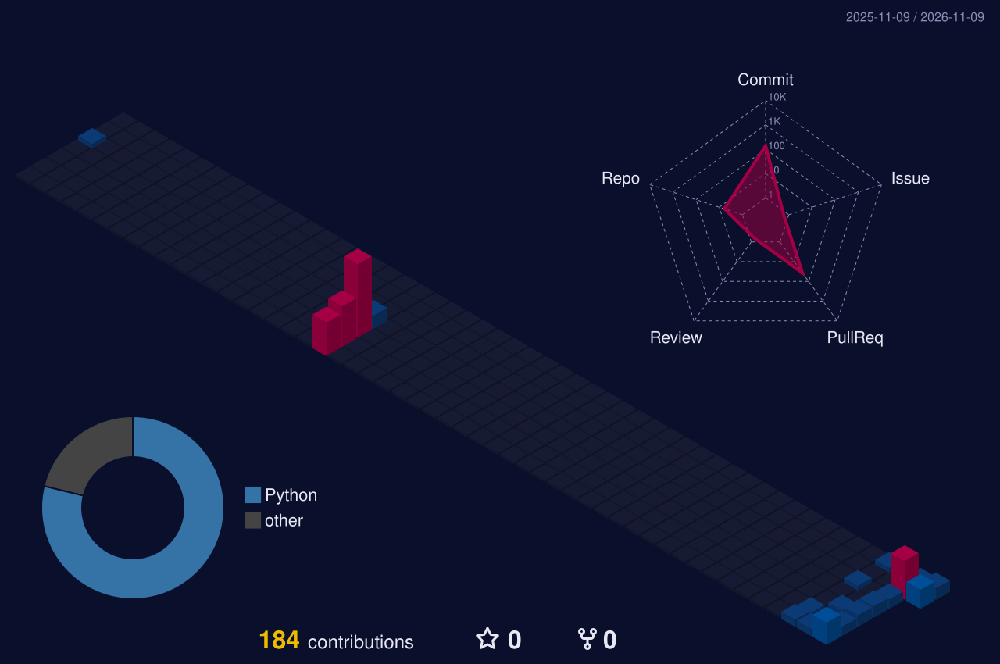

<div align="center">



<a href="https://git.io/typing-svg"></a>

<p>
  <a href="https://github.com/shirsha2002"></a>
  <a href="https://codevexor.tech/"></a>
  
  
</p>

</div>


## ⚽ The Starting XI — About Me

<table>
<tr>
<td width="58%" valign="top">

I'm a software engineer playing in the space where **data, computer vision and practical automation** meet. Chief Advisor at **[Code Vexor](https://codevexor.tech/)** ([GitHub](https://github.com/Code-Vexor)).

🔵 **Midfield (core):** Python, data engineering, automation<br />
🔴 **Attack (research):** monocular depth & color-constancy experiments<br />
🟡 **Training ground:** big-data analytics with Hive, Hadoop & MapReduce<br />
📍 **Home stadium:** Chengdu, Sichuan<br />
🎯 **Season goal:** ship reproducible, well-measured projects<br />

</td>
<td width="42%" valign="top">

```yaml
player:   Shirsha Mitra
position: Data & Vision Engineer
club:     Open Source FC
formation: 4-3-3
  defence:  [tests, reproducibility, docs, git]
  midfield: [Python, Spark, Hive]
  attack:   [Computer Vision, Big Data, Automation]
philosophy: "Possession → Pattern → Goal"
motto:      "Més que un coder"
```

</td>
</tr>
</table>


## 🛠️ The Squad — Tech Stack

<div align="center">


<br /><br />


<br /><br />


</div>


## 🏆 Trophy Cabinet — Featured Work

<table>
<tr>
<td width="50%" valign="top">

### 🔵 [Color Constancy & Depth](https://github.com/shirsha2002/color-constancy-depth-thesis)
Monocular-depth thesis work: paired-light experiments, trained adapters, audited results and reproducible progress reports.

  

</td>
<td width="50%" valign="top">

### 🔴 [Big Data Yelp Analysis](https://github.com/shirsha2002/BigData-Yelp_Analysis)
Large-scale analysis of Yelp business reviews with Apache Hive, Hadoop and MapReduce to surface actionable patterns.

  

</td>
</tr>
<tr>
<td width="50%" valign="top">

### 🟡 [Agent Space Fractions](https://github.com/shirsha2002/agent-space-fractions)
An engineering workspace for agent-oriented ideas and practical automation.

 

</td>
<td width="50%" valign="top">

### ⚪ [Python Journey](https://github.com/shirsha2002/Python-Journey)
A growing record of Python practice — the fundamentals behind every bigger build.

 

</td>
</tr>
</table>


## 🏟️ Camp Nou in 3D — Contribution Skyline

<div align="center"><a href="https://github.com/shirsha2002"></a></div>
<br />

<div align="center">
  
</div>

## 📊 Match Stats

<div align="center">


</div>

## 🐍 Dribbling Through Contributions — @shirsha2002

<div align="center">
  
</div>


<div align="center">

### 🤝 Let's play on the same team

Open to thoughtful conversations, interesting technical problems and chances to learn together.

<a href="https://codevexor.tech/"></a>
<a href="https://github.com/Code-Vexor"></a>
<a href="https://github.com/shirsha2002?tab=repositories"></a>

<br /><br />


</div>
